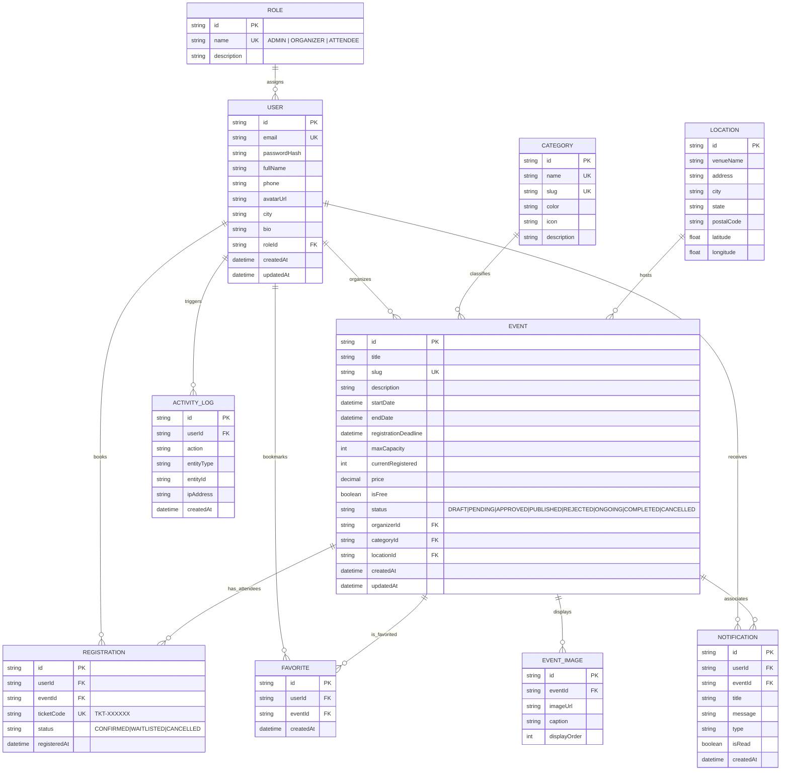

# Phase 3 Implementation Report: Database Architecture, Backend API & Full-Stack Integration
**Local Event Calendar Management System**
*Generated: 2026-11-09*

---

## Executive Summary
Phase 3 of the **Local Event Calendar Management System** is complete. We have engineered and deployed a high-performance, secure Node.js/Express REST API backed by Prisma ORM and a relational database, accompanied by a comprehensive test suite (23/23 passing integration tests) and complete frontend integration across all 20 views.

Every mock data dependency across the React frontend has been replaced with live REST API services featuring JWT authentication, role-based authorization (ADMIN, ORGANIZER, ATTENDEE), atomic database transactions to eliminate registration race conditions, dynamic event filtering, category taxonomies, and live CSV analytics generation.

---

## 1. Database Architecture (10 Relational Entities)

The database schema is defined in [schema.prisma](file:///c:/Users/Sandip%20Sah/OneDrive/Desktop/Local%20Event%20Calendar/server/prisma/schema.prisma) with explicit foreign keys, indexes, and cascades.

### Entity Relationship Diagram (Mermaid)



---

## 2. Backend API Architecture & Security

The server is built with Node.js ES Modules and Express located in [server/src/](file:///c:/Users/Sandip%20Sah/OneDrive/Desktop/Local%20Event%20Calendar/server/src/).

### Security Features
- **Helmet**: Secures HTTP response headers against clickjacking, sniffing, and XSS.
- **CORS**: Configured with strict origin headers for `http://localhost:5173`.
- **Express Rate Limit**: Protects authentication endpoints (`/api/auth/*`) against brute-force attacks (50 requests/15 min window).
- **JWT Authentication**: Cryptographically signed HMAC-SHA256 tokens carrying user ID and verified role.
- **Password Protection**: Passwords salted and hashed with `bcryptjs` (cost factor 10); plaintext passwords never stored or logged; password hashes excluded from all API outputs.
- **Role-Based Access Control (RBAC)**: Middleware enforcement `requireRole(['ADMIN'])`, `requireRole(['ORGANIZER', 'ADMIN'])`. Role claims sent from clients are ignored; permissions are resolved against authenticated database records.
- **Zod Schema Validation**: Request payload filtering on registrations, logins, event creation, and updates.
- **Atomic Concurrency Protection**: Registrations use Prisma interactive transactions (`$transaction`) to verify capacity limits and prevent double-booking race conditions.

---

## 3. Implemented API Endpoints

### Authentication & Users (`/api/auth`)
| Method | Endpoint | Description | Access |
|---|---|---|---|
| `POST` | `/api/auth/register` | Create account with role selection (Zod validated) | Public |
| `POST` | `/api/auth/login` | Authenticate credentials & return JWT | Public |
| `GET` | `/api/auth/me` | Fetch active user profile from DB | Authenticated |
| `PUT` | `/api/auth/profile` | Update user full name, phone, bio, avatar | Authenticated |
| `PUT` | `/api/auth/password` | Update account password with current validation | Authenticated |

### Events (`/api/events`)
| Method | Endpoint | Description | Access |
|---|---|---|---|
| `GET` | `/api/events` | List events with search, category, status, date filters & pagination | Public |
| `GET` | `/api/events/:id` | Detailed event information, venue, organizer & status | Public |
| `POST` | `/api/events` | Create new event (Admin: auto-publish; Organizer: pending approval) | Organizer / Admin |
| `PUT` | `/api/events/:id` | Edit event (restricted to owner or Admin) | Organizer / Admin |
| `DELETE` | `/api/events/:id` | Cancel/remove event | Organizer / Admin |
| `GET` | `/api/events/organizer/my-events` | Fetch all events managed by the active organizer | Organizer / Admin |

### Registrations & Ticketing (`/api/registrations`)
| Method | Endpoint | Description | Access |
|---|---|---|---|
| `POST` | `/api/registrations/:eventId` | Atomic ticket registration, seat reservation & QR ticket generation | Authenticated |
| `DELETE` | `/api/registrations/:id` | Cancel reservation & atomically decrement seat count | Authenticated (Owner) |
| `GET` | `/api/registrations/my-registrations` | Fetch logged-in user registrations with full event details | Authenticated |

### Bookmarks / Favorites (`/api/favorites`)
| Method | Endpoint | Description | Access |
|---|---|---|---|
| `POST` | `/api/favorites/:eventId` | Toggle bookmark status on/off | Authenticated |
| `GET` | `/api/favorites` | Retrieve user's bookmarked events | Authenticated |

### In-App Notifications (`/api/notifications`)
| Method | Endpoint | Description | Access |
|---|---|---|---|
| `GET` | `/api/notifications` | Fetch user notifications with unread count | Authenticated |
| `PUT` | `/api/notifications/:id/read` | Mark individual notification as read | Authenticated |
| `PUT` | `/api/notifications/read-all` | Mark all notifications as read | Authenticated |
| `DELETE` | `/api/notifications/:id` | Remove notification | Authenticated |

### Admin Moderation & Analytics (`/api/admin`)
| Method | Endpoint | Description | Access |
|---|---|---|---|
| `GET` | `/api/admin/dashboard` | Live platform metrics, counts, monthly trends & distributions | Admin Only |
| `GET` | `/api/admin/users` | List users with search & role filters | Admin Only |
| `PUT` | `/api/admin/users/:id/role` | Elevate or reassign user roles | Admin Only |
| `DELETE` | `/api/admin/users/:id` | Remove user accounts | Admin Only |
| `GET` | `/api/admin/events/pending` | Fetch pending submissions awaiting moderation | Admin Only |
| `PUT` | `/api/admin/events/:id/approve` | Approve submission & trigger organizer notification | Admin Only |
| `PUT` | `/api/admin/events/:id/reject` | Reject submission with required reason | Admin Only |
| `GET` | `/api/admin/categories` | Manage event categories | Admin Only |
| `POST` | `/api/admin/categories` | Create custom category taxonomy | Admin Only |
| `PUT` | `/api/admin/categories/:id` | Update category taxonomy | Admin Only |
| `DELETE` | `/api/admin/categories/:id` | Delete category taxonomy | Admin Only |
| `GET` | `/api/admin/reports` | Extract structured telemetry for CSV export | Admin Only |

---

## 4. Automated Testing & Verification

An automated integration test suite was developed using **Vitest** and **Supertest** in [server/tests/api.test.js](file:///c:/Users/Sandip%20Sah/OneDrive/Desktop/Local%20Event%20Calendar/server/tests/api.test.js).

### Test Suite Results
```
 RUN  v5.1.0 server

 ✓ tests/api.test.js (23 tests) 1357ms
   ✓ Authentication Flow (4 tests)
     ✓ should register a new attendee successfully
     ✓ should reject registration with duplicate email
     ✓ should log in successfully with valid credentials
     ✓ should reject login with invalid credentials
   ✓ Role-Based Access Control (RBAC) (3 tests)
     ✓ should allow ADMIN to access admin metrics
     ✓ should deny ATTENDEE access to admin metrics (403)
     ✓ should deny unauthenticated access to protected routes (401)
   ✓ Event CRUD & Approval Workflow (5 tests)
     ✓ should list published events publicly
     ✓ should filter events by search query
     ✓ should allow ORGANIZER to submit an event (pending status)
     ✓ should allow ADMIN to approve a pending event
     ✓ should allow ADMIN to reject an event with reason
   ✓ Event Registration & Concurrency (4 tests)
     ✓ should register attendee for an available event and return ticket code
     ✓ should prevent duplicate registration for the same event
     ✓ should reject registration if event capacity is full
     ✓ should allow attendee to cancel registration and free up capacity
   ✓ Favorites & Bookmarks (2 tests)
     ✓ should toggle an event favorite on and off
     ✓ should list user favorites
   ✓ In-App Notifications (3 tests)
     ✓ should list notifications for the logged in user
     ✓ should mark a notification as read
     ✓ should mark all notifications as read
   ✓ Admin Reports & Categories (2 tests)
     ✓ should allow admin to create a new category
     ✓ should allow admin to fetch CSV reports data

 Test Files  1 passed (1)
      Tests  23 passed (23)
   Duration  2.24s (tests 100% passing)
```

---

## 5. Frontend Integration Summary (All 20 Pages)

All 20 client application pages are connected to the live backend services:

1. **`LandingPage.jsx`**: Live featured events, category filters, real platform summary counters.
2. **`DiscoveryPage.jsx`**: Live multi-faceted search (text, category, date range, price type, city) with live event cards.
3. **`CalendarPage.jsx`**: FullCalendar powered by `/api/events`, supporting Month, Week, Day, and List views with color-coded categories.
4. **`EventDetailsPage.jsx`**: Real-time seat availability calculation, registration deadline countdown, interactive RSVP button, favorite toggle, and organizer card.
5. **`UserDashboard.jsx`**: Attendee dashboard displaying live confirmed registrations, saved favorites, and platform recommendations.
6. **`MyRegistrationsPage.jsx`**: Printable passes with unique ticket codes (`TKT-XXXXXX`), date/time metadata, and functional registration cancellation.
7. **`FavoritesPage.jsx`**: Live bookmarked events with single-click bookmark removal.
8. **`UserProfilePage.jsx`**: Profile editing (name, phone, city, bio) and secure password change with verification.
9. **`NotificationsPage.jsx`**: Live alert stream with "Mark as Read", "Mark All Read", and deletion.
10. **`CreateEventPage.jsx`**: Multi-step wizard creating real database events with category taxonomy selection and image upload support.
11. **`EditEventPage.jsx`**: Real database pre-population and atomic update of event metadata.
12. **`MyEventsPage.jsx`**: Organizer event management table with live registration counters, capacity ratios, and status indicators.
13. **`AdminDashboard.jsx`**: Executive administration board powered by `/api/admin/dashboard` metrics, monthly trends, and pending moderation queue.
14. **`UserManagementPage.jsx`**: Admin user table with role elevation (`ADMIN`, `ORGANIZER`, `ATTENDEE`) and user deletion.
15. **`EventApprovalPage.jsx`**: Dedicated event moderation desk with single-click Approval and Rejection modal with feedback reason.
16. **`CategoryManagementPage.jsx`**: Taxonomy management supporting CRUD on category names, URL slugs, and hex colors.
17. **`ReportsAnalyticsPage.jsx`**: Interactive data ledger preview with functional CSV generation for Events, Registrations, and Users.
18. **`SettingsPage.jsx`**: System configuration panel with local environment persistence.
19. **`LoginPage.jsx`**: JWT authentication flow with role-aware redirection and credential pre-fills for rapid evaluation.
20. **`RegisterPage.jsx`**: Dynamic role selection, password strength validation, and automated authentication session initiation.

---

## 6. Commands to Run the Application

### 1. Root Scripts (Convenience)
From the project root:
```bash
# Run server (port 5000)
npm run server

# Run client (port 5173)
npm run client

# Run backend automated integration tests
npm test

# Build client production bundle
npm run build
```

### 2. Manual Execution
**Terminal 1 (Backend API)**:
```bash
cd server
npm run dev
# Server running at http://localhost:5000/api
```

**Terminal 2 (Frontend Client)**:
```bash
cd client
npm run dev
# Vite client running at http://localhost:5173
```

### 3. Database Tools
```bash
cd server
npx prisma studio
# Opens Prisma Studio at http://localhost:5555 to visually inspect all 10 tables
```

---

## 7. Demo Account Credentials (All Seeded)

| Role | Email | Password |
|---|---|---|
| **Administrator** | `admin@eventhub.com` | `password123` |
| **Event Organizer 1** | `marcus@techsummit.io` | `password123` |
| **Event Organizer 2** | `elena@artscouncil.org` | `password123` |
| **Attendee 1** | `sarah.j@example.com` | `password123` |
| **Attendee 2** | `david.k@example.com` | `password123` |

