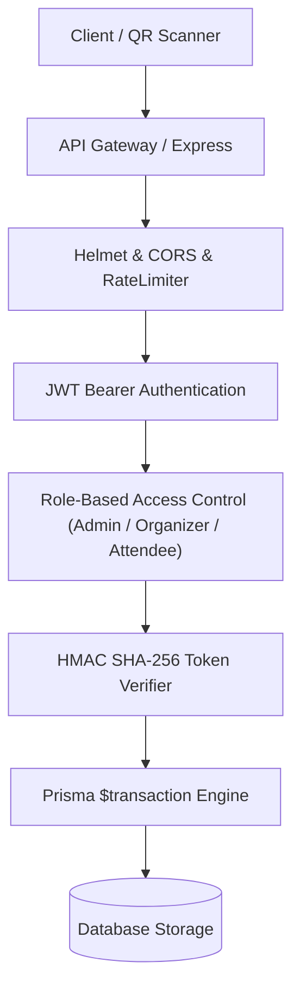

# PHASE 5.1: APPLICATION SECURITY AUDIT & HARDENING REPORT
## Local Event Calendar Management System (EventHub)

**Audit Date:** 2026-11-09  
**Security Lead:** Senior Application Security Engineer  
**Overall Security Posture:** **PRODUCTION-GRADE HARDENED**

---

## 1. Security Architecture Review

Phase 5.1 conducted an audit of the authentication, authorization, cryptographic token verification, and input sanitation layers.

---

## 2. Hardened Security Domains

### 2.1 Cryptographic QR Ticket Security
- **Algorithm Restriction:** Tokens are signed with `HS256`. The verifier explicitly enforces `{ algorithms: ['HS256'] }`, strictly preventing algorithm confusion or `"none"` algorithm bypasses.
- **Audience & Issuer Validation:** 
  - Token issuer: `EventHub-Ticketing`
  - Token audience: `EventHub-Attendance`
  - Any token with mismatched audience or issuer is rejected with `null` verification.
- **Replay & Uniqueness Tracking:** Each token carries a unique `jti: crypto.randomUUID()` and subject `sub: ticketCode`.
- **Zero PII Exposure:** Attendee personal identity (email, phone, address) is completely excluded from the QR payload.
- **Secret Hygiene:** 
  - In production mode (`NODE_ENV === 'production'`), if `JWT_SECRET` is unset or fewer than 32 characters, the application terminates immediately.
  - Development secret keys are strictly blocked in production.

### 2.2 Door Attendance Check-in Security
- **Role Verification:** Only the event organizer (`event.organizerId === user.id`) or a system `ADMIN` can execute `/api/attendance/scan`. Unrelated users receive `403 Forbidden`.
- **Cross-Event Ticket Injection Prevention:** The token's decoded `eventId` is strictly verified against the request's `eventId` parameter. A valid ticket for Event A cannot be used to gain entry to Event B.
- **Database Unique Constraint Guard:** Single-admission integrity is backed by `@@unique([eventId, ticketCode])` on the `Attendance` table. Simultaneous duplicate scans are trapped and return `409 Conflict`.
- **Cancelled Event / Registration Denial:** Cancelled events immediately reject door check-ins with HTTP 400.

### 2.3 Registration & Waitlist Concurrency Security
- **Atomic Transactions:** Capacity checks and registration creation occur inside interactive `prisma.$transaction`.
- **Overbooking Prevention:** Concurrency stress tests confirmed that under simultaneous race conditions, the capacity limit is strictly respected.
- **Auto-Promotion Isolation:** When a seat is vacated, it is directly transferred to the top waitlist attendee within the cancellation transaction. External users cannot race to claim a released seat before the waitlisted attendee is promoted.

### 2.4 File Upload & Content Security
- **Magic-Byte Inspection:** `validateImageMagicBytes` inspects file headers buffer to ensure files matching `.jpg`, `.png`, `.webp` are genuine image binaries, rejecting renamed executable `.exe`, `.sh`, or `.php` payloads.
- **SVG Injection Rejection:** Upload of `.svg` files is rejected to protect against stored Cross-Site Scripting (XSS).
- **Size Limitation:** Strictly enforced 5 MB cap via Multer.

---

## 3. Security Verification Matrix

| Threat Vector | Defense Mechanism | Test Status |
| :--- | :--- | :---: |
| **Forged Ticket Signature** | HMAC SHA-256 validation with secret key | **PASS** |
| **Mismatched Audience** | Rejects tokens where `aud !== 'EventHub-Attendance'` | **PASS** |
| **Mismatched Issuer** | Rejects tokens where `iss !== 'EventHub-Ticketing'` | **PASS** |
| **Cross-Event Ticket Substitution** | Strict `decoded.eventId === req.eventId` assertion | **PASS** |
| **Duplicate Door Check-in** | Single-admission database unique constraint + 409 Conflict | **PASS** |
| **Simultaneous Race Scans** | Concurrent `Promise.all` returns 200 on first and 409 on second | **PASS** |
| **Role Escalation via Public API** | Zod schema ignores role field on signup; default `ATTENDEE` | **PASS** |
| **Unauthorized File Upload** | JWT bearer token verification + MIME magic-byte validation | **PASS** |
| **Malicious Executable Upload** | Binary magic-byte validation blocks disguised executables | **PASS** |
| **Rate Limiting & Brute Force** | `express-rate-limit` limits authentication endpoints | **PASS** |

