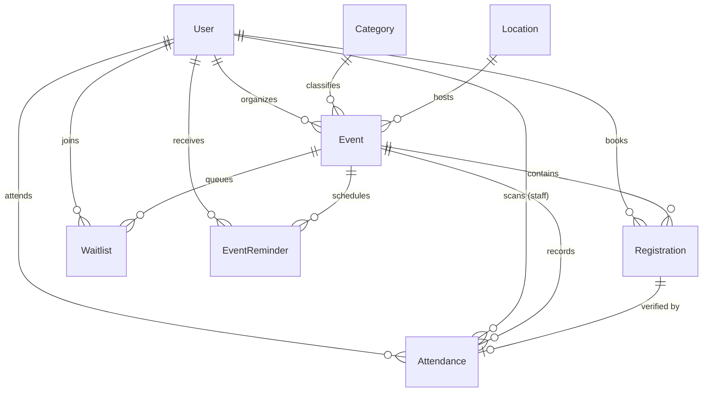

# PHASE 5: DATABASE ARCHITECTURE & SCHEMA DOCUMENTATION
## Local Event Calendar Management System

**ORM:** Prisma ORM  
**Providers:** SQLite (Development & Testing) & PostgreSQL (Production)  
**Schema Files:** `server/prisma/schema.prisma` & `server/prisma/schema.postgresql.prisma`

---

## 1. Entity Relationship Overview

Phase 5 expanded the 10 core entities established in Phase 3 to 13 relational entities, adding:
1. `Waitlist`
2. `Attendance`
3. `EventReminder`
Plus enhancements to the existing `Registration` entity.

---

## 2. Detailed Data Models

### 2.1 Model: `Waitlist`
Maintains the fair queue for sold-out events.

| Column | Type | Attributes | Description |
| :--- | :--- | :--- | :--- |
| `id` | String | `@id @default(cuid())` | Unique waitlist identifier |
| `eventId` | String | Foreign Key | Linked event |
| `userId` | String | Foreign Key | Waiting attendee |
| `status` | String | `@default("PENDING")` | `PENDING`, `OFFERED`, `ACCEPTED`, `EXPIRED`, `CANCELLED` |
| `position` | Int | `@default(1)` | Order in queue (1-based) |
| `offeredAt` | DateTime? | Nullable | Timestamp when seat opened |
| `expiresAt` | DateTime? | Nullable | Claim deadline |
| `createdAt` | DateTime | `@default(now())` | Entry timestamp |
| `updatedAt` | DateTime | `@updatedAt` | Status change timestamp |

- **Constraints & Indexes:**
  - `@@unique([userId, eventId])`: A user can only hold one waitlist spot per event.
  - `@@index([eventId])`: Fast queue lookups per event.
  - `@@index([userId])`: Quick attendee query.
  - `@@index([status])`: Filter active vs processed entries.

---

### 2.2 Model: `Attendance`
Audit-compliant door check-in ledger preventing double-scanning.

| Column | Type | Attributes | Description |
| :--- | :--- | :--- | :--- |
| `id` | String | `@id @default(cuid())` | Unique attendance check-in ID |
| `eventId` | String | Foreign Key | Event being attended |
| `registrationId`| String?| `@unique` Foreign Key | 1-to-1 link with registration pass |
| `userId` | String | Foreign Key | Attendee admitted |
| `ticketCode` | String | Indexed | Plaintext ticket code matching pass |
| `scannedById` | String | Foreign Key | Staff / Organizer performing check-in |
| `scannedAt` | DateTime | `@default(now())` | Exact admission timestamp |
| `method` | String | `@default("QR")` | Check-in mechanism (`QR` or `MANUAL`) |
| `notes` | String? | Nullable | Optional gate / VIP notes |

- **Constraints & Indexes:**
  - `@@unique([eventId, ticketCode])`: Enforces single admission per pass. Re-scanning immediately trips database uniqueness.
  - `@@index([eventId])`: Fast roster queries.
  - `@@index([userId])`: User attendance history.
  - `@@index([ticketCode])`: Fast code lookup.

---

### 2.3 Model: `EventReminder`
Idempotent tracker ensuring scheduled alerts are dispatched exactly once.

| Column | Type | Attributes | Description |
| :--- | :--- | :--- | :--- |
| `id` | String | `@id @default(cuid())` | Unique reminder record ID |
| `eventId` | String | Foreign Key | Event to remind about |
| `userId` | String | Foreign Key | Recipient user |
| `reminderType`| String | Indexed | Type: `24H` or `2H` |
| `scheduledFor`| DateTime | Indexed | Target event start time |
| `sentAt` | DateTime?| Nullable | Dispatch timestamp |
| `status` | String | `@default("PENDING")` | `PENDING`, `SENT`, `FAILED` |
| `createdAt` | DateTime | `@default(now())` | Record creation timestamp |

- **Constraints & Indexes:**
  - `@@unique([eventId, userId, reminderType])`: Strictly prevents duplicate reminders for the same user, event, and window.
  - `@@index([scheduledFor])`: Optimized index for scheduler queries.
  - `@@index([status])`: Fast filter for pending notifications.

---

### 2.4 Model: `Registration` (Enhanced)
Enhanced in Phase 5 to support ticket lifecycle tracking and 1-to-1 link with `Attendance`.

- **Added Fields:**
  - `ticketStatus String @default("VALID")`: Tracks lifecycle (`VALID`, `USED`, `CANCELLED`, `EXPIRED`).
  - `attendance Attendance?`: Direct 1-to-1 relation with door admission record.

---

## 3. Concurrency & Transactional Invariants

1. **Auto-Promotion Invariant**:
   - Executed inside a single `prisma.$transaction`.
   - When a user cancels their registration:
     1. Status set to `CANCELLED`.
     2. If `Waitlist` has a `PENDING` user at `position: 1`:
        - That user's waitlist record is updated to `ACCEPTED`.
        - A confirmed `Registration` is atomically created for the waitlisted user.
        - `currentRegistered` seat count remains unchanged (preventing race conditions from public users stealing the seat).
        - Subsequent waitlist entries have their `position` decremented atomically (`position: { decrement: 1 }`).
     3. If no waitlist exists, `event.currentRegistered` decrements by 1.
2. **Double-Scanning Invariant**:
   - Uniqueness constraint `@@unique([eventId, ticketCode])` on `Attendance` guarantees zero duplicate check-in admissions even if two scanners read the same ticket at the exact same millisecond.

